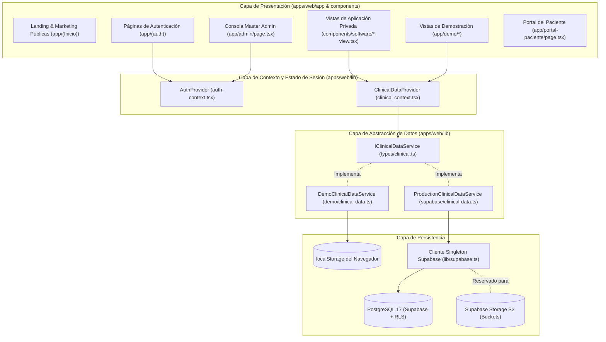
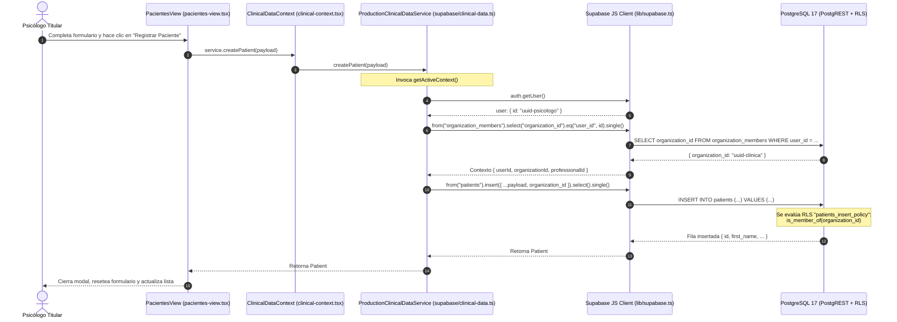

# SYNKRO — Arquitectura del Sistema

> **Documento de Especificación Arquitectónica**  
> **Producto:** Synkro (VelyonSoft)  
> **Fecha de Auditoría:** Octubre 2026

---

## 1. Topología del Monorepo

Synkro está estructurado como un monorepo gestionado por `pnpm workspaces` mediante el archivo de configuración raíz [`pnpm-workspace.yaml`](file:///c:/Users/User/Desktop/Synkro/pnpm-workspace.yaml):

```yaml
packages:
  - apps/*
  - packages/*
```

### Distribución de Carpetas Reales

- `apps/web`: Contiene la aplicación web unificada (landing marketing, autenticación, aplicación SaaS clínica, consola admin y entorno de demostración).
- `supabase`: Contiene la configuración de la infraestructura backend local gestionada por Supabase CLI y Docker, incluyendo migraciones canónicas, scripts de respaldo y configuración de servicios.
- `packages`: Declarado en el archivo de workspaces pero actualmente no contiene paquetes compartidos; toda la lógica se concentra en `apps/web` y `supabase`.

---

## 2. Responsabilidades por Capa



### Detalle de Responsabilidades

1. **Rutas (App Router `apps/web/app/`):**
   - Actúan como puntos de entrada URL limpios.
   - En su gran mayoría son delgados contenedores que importan las vistas maestras de `components/software/` o renderizan componentes de servidor estáticos (como en la landing).
2. **Componentes Maestros de Vista (`components/software/*-view.tsx`):**
   - Albergan el estado de interacción, modales, formularios, tablas, calendarios y paginaciones.
   - Se desacoplan del origen de datos consumiendo exclusivamente el contexto `useClinicalData()`.
3. **Contexto Clínico (`lib/clinical-context.tsx`):**
   - Determina en tiempo de ejecución si el árbol de componentes está montado en modo `"demo"` o `"production"`.
   - Provee la instancia adecuada de `IClinicalDataService` y expone el prefijo de rutas `basePath` (`"/demo"` o `""`).
4. **Contexto de Autenticación (`lib/auth-context.tsx`):**
   - Maneja la sesión del usuario mediante el cliente de Supabase en el navegador.
   - Sincroniza el perfil del usuario consultando la tabla `public.profiles`.
5. **Servicios de Datos (`lib/supabase/clinical-data.ts` y `lib/demo/clinical-data.ts`):**
   - `DemoClinicalDataService`: Realiza operaciones CRUD sobre arrays en memoria y sincroniza con `localStorage`.
   - `ProductionClinicalDataService`: Realiza consultas directas a las tablas PostgreSQL de Supabase mediante `@supabase/supabase-js`.

---

## 3. Patrones de Diseño Verificados

### 3.1 Patrón Service / Adapter (Estrategia)
El sistema utiliza una interfaz común `IClinicalDataService` definida en [`lib/types/clinical.ts`](file:///c:/Users/User/Desktop/Synkro/apps/web/lib/types/clinical.ts). Las dos implementaciones (`DemoClinicalDataService` y `ProductionClinicalDataService`) son intercambiables. Esto permite:
- Probar flujos clínicos completos sin credenciales de base de datos ni conexión a internet.
- Cambiar la fuente de persistencia sin modificar una sola línea de los componentes visuales.

### 3.2 Dual Routing con Next.js Rewrites
En [`apps/web/next.config.ts`](file:///c:/Users/User/Desktop/Synkro/apps/web/next.config.ts) se encuentra configurada la siguiente regla de reescritura de URLs:

```typescript
async rewrites() {
  return [
    {
      source: "/software/:path*",
      destination: "/:path*",
    },
  ];
}
```

**Propósito:** Permite que enlaces o accesos que utilicen el prefijo de branding `/software/agenda` o `/software/pacientes` se resuelvan internamente hacia `/agenda` y `/pacientes` (mapeados físicamente a la carpeta de grupo de rutas `app/(software)/`).

### 3.3 Componentes Client-Driven
La práctica totalidad de las rutas operativas (`(software)`, `demo`, `admin`, `portal-paciente`, `(auth)`) llevan la directiva `"use client"`. No se están aprovechando actualmente las Server Actions de Next.js ni los React Server Components (RSC) para el data-fetching privado; todas las consultas se ejecutan en el ciclo de vida del cliente (`useEffect`) vía PostgREST.

---

## 4. Flujo Detallado de una Petición (End-to-End)

A continuación se ilustra el ciclo de vida de una operación típica en producción (ej. Registro de un nuevo paciente):



---

## 5. Decisiones Técnicas y Limitaciones Arquitectónicas

1. **Cliente Singleton en el Navegador:**  
   [`apps/web/lib/supabase.ts`](file:///c:/Users/User/Desktop/Synkro/apps/web/lib/supabase.ts) crea una única instancia exportada `supabase = createClient(...)`.
   - *Ventaja:* Simplicidad de uso directo en hooks y componentes de React.
   - *Desventaja:* No permite verificar tokens JWT en el servidor mediante cookies HttpOnly ni utilizar middleware de Next.js para protección SSR estricta.
2. **Ausencia de `@supabase/ssr`:**  
   No se utiliza el paquete oficial `@supabase/ssr` ni helpers modernos de servidor (`createServerClient`). Toda la autenticación depende de la sincronización de sesión en el almacenamiento local del navegador (`persistSession: true`).
3. **Carga en Memoria de Colecciones Completas:**  
   En vistas como [`paciente-detail-view.tsx`](file:///c:/Users/User/Desktop/Synkro/apps/web/components/software/paciente-detail-view.tsx), el detalle de un paciente se obtiene descargando todas las sesiones y citas de la organización (`service.getSessions()`, `service.getAppointments()`) y filtrando con `.filter(s => s.patient_id === id)` en el navegador, en lugar de solicitar al servidor únicamente los registros correspondientes al paciente específico.
4. **Almacenamiento Binario Desconectado:**  
   En [`documentos-view.tsx`](file:///c:/Users/User/Desktop/Synkro/apps/web/components/software/documentos-view.tsx), la creación de un archivo clínico registra la metadata en la tabla `patient_files`, pero no ejecuta la llamada de subida de bytes al bucket S3 (`supabase.storage.from("patient-files").upload(...)`).

---

## 6. Recomendaciones de Evolución Arquitectónica

1. **Migración a `@supabase/ssr` y Cookies:**  
   Implementar autenticación basada en cookies seguras para habilitar `middleware.ts` en la raíz de `apps/web/` y proteger rutas antes del envío del primer byte de HTML.
2. **Parametrización de Servicios Clínicos:**  
   Incorporar métodos con filtro directo en `IClinicalDataService` (ej. `getSessionsByPatient(patientId: string)`, `getAppointmentsByPatient(patientId: string)`).
3. **Consolidación de Paquetes Compartidos (`packages/`):**  
   Si el proyecto prevé la creación de una aplicación móvil (React Native / Expo) o portales adicionales, extraer `lib/types/clinical.ts` y la capa de servicios hacia un paquete interno `packages/clinical-core`.

