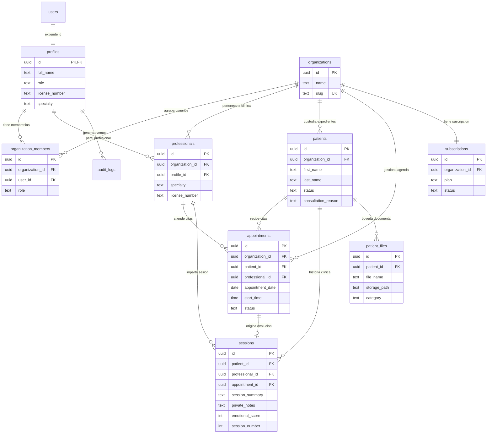

# SYNKRO — Modelo de Datos y Especificación de Base de Datos

> **Documento Técnico de Base de Datos y Seguridad RLS**  
> **Motor:** PostgreSQL 17 (Supabase)  
> **Migración Canónica:** `supabase/migrations/20261003000000_initial_schema.sql`  
> **Fecha de Auditoría:** Octubre 2026

---

## 1. Resumen del Esquema y Extensiones

El modelo de base de datos de Synkro está diseñado bajo un esquema multi-inquilino (*multi-tenant*) donde el núcleo de aislamiento es la tabla `organizations`. Cada consulta a recursos clínicos (`patients`, `appointments`, `sessions`, `patient_files`) se filtra a través de la pertenencia del usuario autenticado a dicha organización.

### Extensiones Habilitadas
1. `"uuid-ossp"` (Schema `extensions`): Generación de identificadores únicos universales (`extensions.uuid_generate_v4()`).
2. `"pg_trgm"` (Schema `public`): Operadores de trigramas para búsqueda textual rápida y difusa de pacientes por nombre completo.

---

## 2. Inventario de Tablas Confirmadas en Migración Canónica

A continuación se detalla cada tabla definida en [`supabase/migrations/20261003000000_initial_schema.sql`](file:///c:/Users/User/Desktop/Synkro/supabase/migrations/20261003000000_initial_schema.sql):

### 2.1 `public.profiles`
- **Finalidad:** Extensión de la tabla de identidad `auth.users` de Supabase con datos profesionales del psicólogo.
- **Clave Primaria:** `id uuid` (FK hacia `auth.users(id) ON DELETE CASCADE`).
- **Columnas:**
  - `id uuid` (PK, FK `auth.users`)
  - `full_name text`
  - `avatar_url text`
  - `role text DEFAULT 'owner' CHECK (role IN ('superadmin', 'admin', 'owner', 'psychologist', 'assistant', 'patient'))`
  - `phone text`
  - `specialty text`
  - `license_number text` (Número de colegiatura C.Ps.P.)
  - `bio text`
  - `office_address text DEFAULT 'Av. Benavides 1570, Miraflores, Lima'`
  - `default_meet_link text DEFAULT 'https://meet.google.com/syn-kro-vely'`
  - `created_at timestamptz DEFAULT now()`
  - `updated_at timestamptz DEFAULT now()`

### 2.2 `public.organizations`
- **Finalidad:** Clínicas, centros o consultorios privados independientes (multi-tenant root).
- **Clave Primaria:** `id uuid DEFAULT extensions.uuid_generate_v4()`.
- **Columnas:**
  - `id uuid` (PK)
  - `name text NOT NULL`
  - `slug text UNIQUE NOT NULL`
  - `logo_url text`
  - `created_at timestamptz DEFAULT now()`

### 2.3 `public.organization_members`
- **Finalidad:** Tabla asociativa muchos a muchos entre perfiles y organizaciones, definiendo el rol dentro de la clínica.
- **Clave Primaria:** `id uuid DEFAULT extensions.uuid_generate_v4()`.
- **Claves Foráneas:**
  - `organization_id uuid REFERENCES public.organizations(id) ON DELETE CASCADE`
  - `user_id uuid REFERENCES public.profiles(id) ON DELETE CASCADE`
- **Restricción Única:** `UNIQUE (organization_id, user_id)`
- **Columnas:**
  - `id uuid` (PK)
  - `organization_id uuid NOT NULL` (FK)
  - `user_id uuid NOT NULL` (FK)
  - `role text NOT NULL CHECK (role IN ('superadmin', 'admin', 'owner', 'psychologist', 'assistant', 'patient'))`
  - `created_at timestamptz DEFAULT now()`

### 2.4 `public.professionals`
- **Finalidad:** Registro formal de psicólogos o terapeutas asignables a citas y sesiones clínicas.
- **Clave Primaria:** `id uuid DEFAULT extensions.uuid_generate_v4()`.
- **Claves Foráneas:**
  - `organization_id uuid REFERENCES public.organizations(id) ON DELETE CASCADE`
  - `profile_id uuid REFERENCES public.profiles(id) ON DELETE CASCADE`
- **Columnas:**
  - `id uuid` (PK)
  - `organization_id uuid NOT NULL` (FK)
  - `profile_id uuid NOT NULL` (FK)
  - `specialty text`
  - `license_number text`
  - `bio text`
  - `created_at timestamptz DEFAULT now()`

### 2.5 `public.patients`
- **Finalidad:** Expedientes clínicos de los pacientes atendidos en la organización.
- **Clave Primaria:** `id uuid DEFAULT extensions.uuid_generate_v4()`.
- **Claves Foráneas:**
  - `organization_id uuid REFERENCES public.organizations(id) ON DELETE CASCADE`
- **Columnas:**
  - `id uuid` (PK)
  - `organization_id uuid NOT NULL` (FK)
  - `first_name text NOT NULL`
  - `last_name text NOT NULL`
  - `email text`
  - `phone text`
  - `birth_date date`
  - `gender text`
  - `notes text`
  - `status text DEFAULT 'activo' CHECK (status IN ('activo', 'inactivo', 'alta', 'evaluacion'))`
  - `therapeutic_approach text DEFAULT 'Cognitivo Conductual (TCC)'`
  - `consultation_reason text`
  - `emergency_contact text`
  - `created_at timestamptz DEFAULT now()`

### 2.6 `public.appointments`
- **Finalidad:** Agenda y citas terapéuticas programadas o históricas.
- **Clave Primaria:** `id uuid DEFAULT extensions.uuid_generate_v4()`.
- **Claves Foráneas:**
  - `organization_id uuid REFERENCES public.organizations(id) ON DELETE CASCADE`
  - `patient_id uuid REFERENCES public.patients(id) ON DELETE CASCADE`
  - `professional_id uuid REFERENCES public.professionals(id) ON DELETE CASCADE`
- **Columnas:**
  - `id uuid` (PK)
  - `organization_id uuid NOT NULL` (FK)
  - `patient_id uuid NOT NULL` (FK)
  - `professional_id uuid NOT NULL` (FK)
  - `appointment_date date NOT NULL`
  - `start_time time without time zone NOT NULL`
  - `end_time time without time zone`
  - `status text DEFAULT 'scheduled' CHECK (status IN ('scheduled', 'completed', 'cancelled', 'no_show'))`
  - `modality text DEFAULT 'presencial' CHECK (modality IN ('presencial', 'virtual'))`
  - `meeting_link text`
  - `notes text`
  - `created_at timestamptz DEFAULT now()`

### 2.7 `public.sessions`
- **Finalidad:** Notas de evolución clínica, historias terapéuticas, tareas intersesión y notas confidenciales (secreto profesional).
- **Clave Primaria:** `id uuid DEFAULT extensions.uuid_generate_v4()`.
- **Claves Foráneas:**
  - `patient_id uuid REFERENCES public.patients(id) ON DELETE CASCADE`
  - `professional_id uuid REFERENCES public.professionals(id) ON DELETE CASCADE`
  - `appointment_id uuid REFERENCES public.appointments(id) ON DELETE SET NULL`
- **Columnas:**
  - `id uuid` (PK)
  - `patient_id uuid NOT NULL` (FK)
  - `professional_id uuid NOT NULL` (FK)
  - `appointment_id uuid` (FK opcional)
  - `session_summary text` (Resumen clínico / Nota SOAP formal)
  - `private_notes text` (Notas confidenciales de contratransferencia)
  - `session_number integer DEFAULT 1`
  - `emotional_score integer CHECK (emotional_score >= 1 AND emotional_score <= 10)`
  - `homework text` (Tareas asignadas para casa)
  - `created_at timestamptz DEFAULT now()`

### 2.8 `public.patient_files`
- **Finalidad:** Registro de documentos clínicos, pruebas psicométricas (Beck, WAIS) y consentimientos informados.
- **Clave Primaria:** `id uuid DEFAULT extensions.uuid_generate_v4()`.
- **Claves Foráneas:**
  - `patient_id uuid REFERENCES public.patients(id) ON DELETE CASCADE`
- **Columnas:**
  - `id uuid` (PK)
  - `patient_id uuid NOT NULL` (FK)
  - `file_name text`
  - `storage_path text` (Ruta esperada en el bucket S3)
  - `file_type text`
  - `category text DEFAULT 'Evaluación'`
  - `file_size text DEFAULT '1.2 MB'`
  - `created_at timestamptz DEFAULT now()`

### 2.9 `public.subscriptions`
- **Finalidad:** Control de planes y facturación de la clínica.
- **Clave Primaria:** `id uuid DEFAULT extensions.uuid_generate_v4()`.
- **Claves Foráneas:**
  - `organization_id uuid REFERENCES public.organizations(id) ON DELETE CASCADE`
- **Columnas:**
  - `id uuid` (PK)
  - `organization_id uuid NOT NULL` (FK)
  - `plan text DEFAULT 'starter' CHECK (plan IN ('starter', 'professional', 'clinic'))`
  - `status text DEFAULT 'active'`
  - `created_at timestamptz DEFAULT now()`

### 2.10 `public.audit_logs`
- **Finalidad:** Registro inmutable de acciones realizadas para auditoría y trazabilidad médica.
- **Clave Primaria:** `id uuid DEFAULT extensions.uuid_generate_v4()`.
- **Claves Foráneas:**
  - `user_id uuid REFERENCES public.profiles(id)`
- **Columnas:**
  - `id uuid` (PK)
  - `user_id uuid` (FK)
  - `action text`
  - `table_name text`
  - `record_id uuid`
  - `created_at timestamptz DEFAULT now()`

---

## 3. Diagrama Entidad-Relación (Mermaid ER)

---

## 4. Índices de Rendimiento y Búsqueda

Los siguientes índices están formalmente declarados para optimizar tiempos de respuesta y evitar Table Scans:

| Nombre del Índice | Tabla | Tipo | Columnas / Expresión | Justificación |
| :--- | :--- | :--- | :--- | :--- |
| `appointments_date_idx` | `appointments` | BTREE | `(appointment_date)` | Filtro por rangos de fecha en la vista de agenda semanal. |
| `patients_search_idx` | `patients` | GIN | `(((first_name \|\| ' ') \|\| last_name) gin_trgm_ops)` | Búsqueda difusa y autocompletado en tiempo real de pacientes por nombre y apellido. |
| `sessions_patient_idx` | `sessions` | BTREE | `(patient_id)` | Carga histórica de notas y evoluciones de un expediente específico. |
| `idx_org_members_user` | `organization_members` | BTREE | `(user_id)` | Optimización de la función RLS `is_member_of` en cada verificación de token. |
| `idx_patients_org` | `patients` | BTREE | `(organization_id)` | Aislamiento RLS multi-tenant de pacientes. |
| `idx_appointments_org` | `appointments` | BTREE | `(organization_id)` | Aislamiento RLS multi-tenant de citas. |
| `idx_professionals_org` | `professionals` | BTREE | `(organization_id)` | Aislamiento RLS multi-tenant de profesionales. |
| `idx_patient_files_patient` | `patient_files` | BTREE | `(patient_id)` | Acceso a la bóveda de pruebas y documentos por paciente. |

---

## 5. Funciones Auxiliares y Triggers de Infraestructura

### 5.1 Trigger `handle_new_user`
- **Disparador:** `AFTER INSERT ON auth.users FOR EACH ROW`.
- **Función:** `public.handle_new_user()`.
- **Propósito:** Al registrarse un usuario en `auth.users`, crea automáticamente su fila en `public.profiles` extrayendo `full_name`, `avatar_url` y `role` (default `'owner'`) de `raw_user_meta_data`.

### 5.2 Trigger `create_default_workspace`
- **Disparador:** `AFTER INSERT ON public.profiles FOR EACH ROW`.
- **Función:** `public.create_default_workspace()`.
- **Propósito:** Al crearse un perfil:
  1. Genera un slug alfanumérico sanitizado con sufijo determinista basado en el ID (`clean_slug || '-' || suffix`).
  2. Inserta la clínica en `public.organizations`.
  3. Asocia al usuario en `public.organization_members` con rol `'owner'`.
  4. Crea una suscripción inicial en `public.subscriptions` con plan `'starter'`.

### 5.3 Funciones Auxiliares RLS Anti-Recursión
Para evitar recursión infinita en las políticas RLS sobre `organization_members`:
- **`public.is_member_of(_org_id uuid) RETURNS boolean`:**  
  `SECURITY DEFINER STABLE`: Ejecuta una subconsulta directa sobre `organization_members` para comprobar si `auth.uid()` pertenece a `_org_id`.
- **`public.has_role_in_org(_org_id uuid, _roles text[]) RETURNS boolean`:**  
  `SECURITY DEFINER STABLE`: Verifica si `auth.uid()` tiene un rol autorizado dentro de la organización especificada.

---

## 6. Políticas de Seguridad a Nivel de Fila (RLS)

Todas las 10 tablas tienen `ALTER TABLE ... ENABLE ROW LEVEL SECURITY;` activado.

| Tabla | Operación | Regla / Expresión RLS | Restricción de Negocio |
| :--- | :--- | :--- | :--- |
| `profiles` | SELECT | `auth.uid() = id OR EXISTS (colegas en misma org)` | Solo ve su propio perfil o perfiles de miembros de su misma clínica. |
| `profiles` | UPDATE | `auth.uid() = id` | Únicamente el propio usuario puede actualizar sus datos. |
| `organizations` | SELECT | `public.is_member_of(id)` | Solo miembros de la clínica pueden ver los datos de la organización. |
| `organizations` | UPDATE | `public.has_role_in_org(id, ['owner', 'admin', 'superadmin'])` | Solo dueños o administradores pueden editar datos de la clínica. |
| `organization_members` | SELECT | `user_id = auth.uid() OR public.is_member_of(organization_id)` | Ve sus membresías y las de sus colegas en la misma clínica. |
| `organization_members` | INSERT/UPDATE | `public.has_role_in_org(organization_id, ['owner', 'admin', 'superadmin'])` | Solo roles jerárquicos pueden agregar o modificar miembros. |
| `patients` | SELECT / INSERT / UPDATE | `public.is_member_of(organization_id)` | Miembros autorizados de la clínica gestionan los pacientes. |
| `patients` | DELETE | `public.has_role_in_org(organization_id, ['owner', 'admin', 'psychologist', 'superadmin'])` | Recepcionistas/asistentes no pueden borrar pacientes. |
| `appointments` | SELECT / INSERT / UPDATE / DELETE | `public.is_member_of(organization_id)` | Miembros de la organización gestionan la agenda de citas. |
| `sessions` | SELECT / INSERT / UPDATE | `EXISTS (paciente pertenece a org Y usuario tiene rol ['owner', 'psychologist', 'admin', 'superadmin'])` | **Secreto profesional:** Excluye formalmente a roles `'assistant'` y `'patient'`. |
| `sessions` | DELETE | `EXISTS (paciente pertenece a org Y usuario tiene rol ['owner', 'admin', 'superadmin'])` | Solo dueños y administradores pueden eliminar registros de sesión. |
| `patient_files` | SELECT / INSERT / UPDATE | `EXISTS (paciente pertenece a org del usuario)` | Acceso a archivos vinculado a la pertenencia de la clínica. |
| `patient_files` | DELETE | `EXISTS (paciente en org Y rol ['owner', 'psychologist', 'admin', 'superadmin'])` | Eliminación restringida a profesionales o administradores. |
| `subscriptions` | SELECT | `public.is_member_of(organization_id)` | Visualización del plan para miembros de la clínica. |
| `subscriptions` | UPDATE | `public.has_role_in_org(organization_id, ['owner', 'admin', 'superadmin'])` | Gestión de suscripción solo para dueños o administradores. |
| `audit_logs` | SELECT / INSERT | `user_id = auth.uid()` / `auth.uid() IS NOT NULL` | Trazabilidad por usuario autenticado. |

---

## 7. Storage (Buckets y Políticas)

Declarados en la sección 7 de la migración canónica:
1. **`avatars` (Público: `true`):**
   - Lectura pública (`bucket_id = 'avatars'`).
   - Inserción/actualización restringida: `(storage.foldername(name))[1] = auth.uid()::text`.
2. **`patient-files` (Público: `false`):**
   - Lectura/Escritura: Validada mediante subconsulta a `public.patients` asegurando que el ID del paciente en la carpeta pertenezca a la organización del usuario (`is_member_of`).

---

## 8. Inconsistencias y Puntos Críticos Identificados

1. **Omisión de Inserción en `public.professionals` tras Registro:**  
   El trigger `create_default_workspace()` crea la organización y la membresía, pero **no** crea un registro en `public.professionals` para el usuario recién registrado.  
   *Consecuencia:* Cuando un nuevo psicólogo intenta agendar una cita (`ProductionClinicalDataService.createAppointment`), la función `getActiveContext()` no encuentra un registro en `professionals` y arroja una excepción bloqueante.
2. **Desconexión con Supabase Storage:**  
   Pese a que las políticas y el bucket `patient-files` están definidos en SQL, el frontend ([`documentos-view.tsx`](file:///c:/Users/User/Desktop/Synkro/apps/web/components/software/documentos-view.tsx)) solo realiza inserts en la tabla relacional `patient_files` sin transferir los archivos binarios a Storage.

