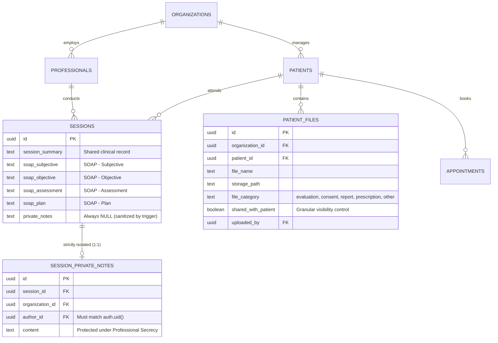

# SYNKRO (VELYONSOFT) — INFORME TÉCNICO Y AUDITORÍA INTEGRAL: FASES 1, 2 Y 3

**Fecha de ejecución:** 28 de Octubre, 2026  
**Autor:** Arquitecto de Software SaaS Senior — VelyonSoft  
**Entorno de ejecución:** Local Supabase (Docker) • Next.js 16.3.6 • React 19 • PostgreSQL 15  
**Estado general:** 67/67 Pruebas Automatizadas Exitosas (0 Fallos) • Compilación Web 100% Limpia (0 Errores TypeScript)

---

## ÍNDICE GENERAL

1. [PARTE A: REVISIÓN Y ESTADO ACTUAL DE LAS FASES 1 Y 2](#parte-a-revisión-y-estado-actual-de-las-fases-1-y-2)
2. [PARTE B: INTEGRACIÓN COMERCIAL DE LA PÁGINA DE INICIO (/)](#parte-b-integración-comercial-de-la-página-de-inicio-)
3. [PARTE C: AUDITORÍA Y ANÁLISIS DE SEGURIDAD PREVIA A LA FASE 3](#parte-c-auditoría-y-análisis-de-seguridad-previa-a-la-fase-3)
4. [PARTE D: ARQUITECTURA E IMPLEMENTACIÓN DE LA FASE 3](#parte-d-arquitectura-e-implementación-de-la-fase-3)
   - [D.1 Separación Estricta de Notas Privadas (Secreto Profesional)](#d1-separación-estricta-de-notas-privadas-secreto-profesional)
   - [D.2 Bóveda Documental y Compartición Granular (`patient_files`)](#d2-bóveda-documental-y-compartición-granular-patient_files)
   - [D.3 Almacenamiento Cifrado y URLs Firmadas (`storage.objects`)](#d3-almacenamiento-cifrado-y-urls-firmadas-storageobjects)
   - [D.4 Notas SOAP y Asistente IA Local Honesto](#d4-notas-soap-y-asistente-ia-local-honesto)
   - [D.5 Portal del Paciente (`/portal-paciente`) Conectado a Datos Reales](#d5-portal-del-paciente-portal-paciente-conectado-a-datos-reales)
5. [PARTE E: RESULTADOS DE LA SUITE DE PRUEBAS AUTOMATIZADAS](#parte-e-resultados-de-la-suite-de-pruebas-automatizadas)
6. [PARTE F: DOCUMENTACIÓN TÉCNICA Y MARCO ÉTICO-LEGAL](#parte-f-documentación-técnica-y-marco-ético-legal)
7. [PARTE G: CONCLUSIÓN Y HOJA DE RUTA PARA LA FASE 4](#parte-g-conclusión-y-hoja-de-ruta-para-la-fase-4)

---

## PARTE A: REVISIÓN Y ESTADO ACTUAL DE LAS FASES 1 Y 2

Antes de realizar cualquier modificación, se ejecutó una auditoría retrospectiva de verificación sobre las migraciones incrementales `20261028210000_phase1_security_and_registration.sql` y `20261028220000_phase2_subscriptions_and_commercial.sql` mediante las suites de pruebas automatizadas:

```bash
& 'C:\nvm4w\nodejs\node.exe' scripts/test-phase1.mjs
# Resultado: 22 PASSED | 0 FAILED

& 'C:\nvm4w\nodejs\node.exe' scripts/test-phase2.mjs
# Resultado: 21 PASSED | 0 FAILED
```

### Tabla Resumen de Hallazgos y Estado Preexistente:

| Componente Auditado | Regla Evaluada | Comportamiento Verificado | Estado |
| :--- | :--- | :--- | :--- |
| **Auth & Profiles** | Auto-asignación de rol privilegiado en registro | Metadatos `platform_role` maliciosos son ignorados; trigger fuerza `user` y `owner`. | ✅ Seguro |
| **Profiles UPDATE** | Modificación directa de `platform_role` o `role` | Trigger `prevent_profile_role_escalation` rechaza updates no emitidos por superadmin. | ✅ Seguro |
| **Aislamiento Multi-Tenant** | Acceso a pacientes de otra organización | Políticas RLS restringen SELECT y UPDATE a organizaciones donde el usuario es miembro activo. | ✅ Seguro |
| **Integridad Relacional Citas** | Cita cruzando paciente y profesional de distintas clínicas | Trigger `validate_appointment_tenant_integrity` aborta transacciones cruzadas. | ✅ Seguro |
| **Integridad Relacional Sesiones** | Sesión cruzando profesional y paciente de distintas clínicas | Trigger `validate_session_tenant_integrity` aborta transacciones cruzadas. | ✅ Seguro |
| **Suscripciones** | Modificación no autorizada de plan o vigencia por el cliente | RLS en `subscriptions` bloquea UPDATE por usuarios regulares; solo superadmin puede modificar planes. | ✅ Seguro |
| **Periodo de Prueba** | Registro inicial de nueva clínica | Se inicializa en estado `trialing` con vigencia calculada exactamente en 14 días. | ✅ Seguro |
| **Continuidad Clínica** | Acceso a datos con suscripción vencida | Operaciones de escritura quedan bloqueadas con mensaje claro; lectura y exportación permanecen 100% habilitadas. | ✅ Seguro |
| **Límites de Plan** | Inserción de segundo profesional en Plan Profesional | Trigger `enforce_plan_professional_limit` bloquea adición si se supera el límite del plan. | ✅ Seguro |

---

## PARTE B: INTEGRACIÓN COMERCIAL DE LA PÁGINA DE INICIO (`/`)

Se actualizó integralmente la página de inicio pública ([`apps/web/app/(Inicio)/page.tsx`](file:///c:/Users/User/Desktop/Synkro/apps/web/app/(Inicio)/page.tsx)) para alinearla al 100% con la estrategia de productización comercial definida en `PLANS_CONFIG` y `COMMERCIAL_CONFIG`:

### 1. Cuadrícula de Planes Comerciales
- **Plan Starter (S/ 49/mes):** Para psicólogos individuales con hasta 30 pacientes activos y 1 profesional. Incluye prueba gratuita de 14 días sin tarjeta de crédito.
- **Plan Profesional (S/ 89/mes - Más Popular):** Para terapeutas con alta demanda. Pacientes ilimitados, 1 profesional, notas SOAP, bóveda documental de 10 GB y reportes de evolución.
- **Plan Clínica (S/ 189/mes):** Para centros de salud mental. Hasta 5 psicólogos incluidos (profesionales adicionales por S/ 35/mes), agenda multi-box y roles de recepción/asistencia.

### 2. Transparencia y Honestidad en Métodos de Pago
- **Eliminación de pasarelas ficticias:** Se retiró cualquier mención simulada a cobros automáticos con tarjetas Visa, Mastercard o pasarelas no integradas.
- **Canales de cobro reales de VelyonSoft:**
  - **Yape:** Al número oficial `997 676 432`.
  - **Transferencia bancaria BCP:** Con confirmación manual en menos de 2 horas.
- **Enlace directo a WhatsApp:** Botón comercial preconfigurado (`wa.me/51997676432`) con mensaje dinámico según el plan seleccionado por el interesado.
- **Prueba gratuita real:** Registro sin tarjeta de crédito (`/registrarse`), acceso inmediato al software por 14 días con límites de prueba activos.

---

## PARTE C: AUDITORÍA Y ANÁLISIS DE SEGURIDAD PREVIA A LA FASE 3

Durante la inspección de la migración canónica `20261003000000_initial_schema.sql` y las vistas clínicas, se detectaron las siguientes vulnerabilidades críticas:

1. **Fuga de Secreto Profesional en `public.sessions`:**
   - La columna `private_notes` residía en la misma fila que `session_summary`.
   - La política RLS `sessions_select_policy` permitía que **cualquier profesional** con rol `psychologist` o `owner` en la clínica leyera la fila completa.
   - **Impacto:** Las notas de contratransferencia, hipótesis sensibles o impresiones personales de un terapeuta eran visibles para sus colegas de la clínica, violando el Código de Ética del Colegio de Psicólogos del Perú (C.Ps.P.) y el deber de secreto profesional.

2. **Carencia de Tenencia y Compartición Granular en `patient_files`:**
   - La tabla `patient_files` no disponía de la columna `organization_id` (dependía de joins implícitos con `patients`).
   - No existía un indicador de visibilidad para el paciente (`shared_with_patient`). Todo archivo asociado a un paciente podía ser expuesto si se le otorgaba acceso al portal.

3. **Inexistencia de Subida Real y URLs Firmadas:**
   - El componente `documentos-view.tsx` solo creaba una fila simulada en base de datos con una ruta ficticia `patient-files/{id}/...` sin subir ningún archivo real al bucket de Supabase Storage.
   - No se generaban enlaces temporales firmados (`createSignedUrl`), dejando el almacenamiento desprotegido o inoperativo.

4. **Portal del Paciente Desconectado:**
   - `portal-paciente/page.tsx` mostraba un listado estático en memoria (`sharedDocuments = [...]`) sin consultar citas ni archivos reales en Supabase.

---

## PARTE D: ARQUITECTURA E IMPLEMENTACIÓN DE LA FASE 3

Se creó y aplicó la migración incremental canónica:  
[`supabase/migrations/20261028230000_phase3_clinical_security_vault.sql`](file:///c:/Users/User/Desktop/Synkro/supabase/migrations/20261028230000_phase3_clinical_security_vault.sql)



### D.1 Separación Estricta de Notas Privadas (Secreto Profesional)
1. **Nueva tabla `public.session_private_notes`:**
   - Columnas: `id`, `session_id UNIQUE`, `organization_id`, `author_id`, `content`, `created_at`, `updated_at`.
   - Índices en `author_id`, `session_id`, `organization_id`.
2. **Políticas RLS Exclusivas para el Autor (`author_id = auth.uid()`):**
   - SELECT, INSERT, UPDATE y DELETE exigen que el usuario sea exactamente el autor (`author_id = auth.uid()`).
   - Ni otros psicólogos de la misma clínica, ni asistentes, ni pacientes pueden consultar ni modificar estas notas.
3. **Migración no destructiva de notas existentes:**
   - Se migraron todas las notas preexistentes de `sessions.private_notes` hacia `session_private_notes`.
   - Se vació la columna antigua: `UPDATE public.sessions SET private_notes = NULL`.
4. **Trigger de sanitización y redirección automática:**
   - `trg_handle_session_private_notes_split` (`AFTER INSERT OR UPDATE ON public.sessions`): si un cliente o consulta antigua envía `private_notes`, el trigger lo redirecciona a `session_private_notes` y sanitiza la columna en `sessions`, impidiendo cualquier fuga en consultas generales.
5. **Protección en `audit_logs`:**
   - Trigger `trg_audit_session_private_notes`: registra la operación con metadatos técnicos (`session_id`, `author_id`, `content_length`) y marca `confidentiality: 'SECRETO_PROFESIONAL_CONTENIDO_PROTEGIDO'`, sin almacenar jamás el contenido en texto plano.

### D.2 Bóveda Documental y Compartición Granular (`patient_files`)
1. **Columnas añadidas a `public.patient_files`:**
   - `organization_id uuid REFERENCES public.organizations(id)`
   - `shared_with_patient boolean NOT NULL DEFAULT false`
   - `uploaded_by uuid REFERENCES auth.users(id)`
   - `file_category text CHECK (file_category IN ('evaluation', 'consent', 'report', 'prescription', 'other'))`
2. **Políticas RLS Granulares:**
   - **Personal clínico/administrativo:** Roles `owner`, `psychologist`, `admin`, `assistant` de la organización pueden ver todos los archivos clínicos.
   - **Pacientes:** Un paciente autenticado puede consultar **únicamente** los archivos pertenecientes a su propio registro de paciente (`email = get_auth_email()`) **Y** que tengan la bandera `shared_with_patient = true`.
   - **Escritura y borrado:** Prohibidos para el rol `patient`.

### D.3 Almacenamiento Cifrado y URLs Firmadas (`storage.objects`)
1. **Bucket Privado `patient-files`:** Configurado como privado (`public = false`).
2. **Políticas de Storage en `storage.objects`:**
   - Lectura autorizada solo para personal clínico de la organización o pacientes con archivo compartido verificado.
   - Subida y borrado restringidos estrictamente al personal clínico de la clínica.
3. **Generación de URLs Firmadas (1 hora de vigencia):**
   - Métodos implementados en [`apps/web/lib/supabase/clinical-data.ts`](file:///c:/Users/User/Desktop/Synkro/apps/web/lib/supabase/clinical-data.ts): `uploadFile(file, patientId, category, sharedWithPatient)` y `getFileSignedUrl(storagePath)`.
   - Las descargas y vistas previas operan mediante tokens criptográficos HMAC de corta duración.

### D.4 Notas SOAP y Asistente IA Local Honesto
1. **Campos SOAP en `public.sessions`:**
   - `soap_subjective`: Motivo manifestado, experiencia personal y síntomas percibidos por el paciente.
   - `soap_objective`: Observación conductual, signos objetivos, lenguaje no verbal, examen mental.
   - `soap_assessment`: Interpretación clínica, formulación funcional, hipótesis diagnóstica.
   - `soap_plan`: Plan terapéutico acordado, acuerdos conductuales y tareas intersesión.
2. **Componente de Sesiones ([`apps/web/components/software/sesiones-view.tsx`](file:///c:/Users/User/Desktop/Synkro/apps/web/components/software/sesiones-view.tsx)):**
   - Selector de pestañas: "Formato SOAP Estándar" vs. "Texto Libre / Resumen".
   - **Asistente de Redacción Local & Privado:**
     - Plantillas clínicas predefinidas: Reestructuración Cognitiva (TCC), Aceptación y Compromiso (ACT), y Evaluación Inicial.
     - Clasificador local determinístico de apuntes libres hacia cuadrantes SOAP.
     - **Aviso de Honestidad e IA Transparente:** Informa claramente al terapeuta que el procesamiento es 100% local en su navegador, que ninguna nota confidencial se transmite a servidores de telemetría de IA de terceros, y que todo borrador requiere validación y supervisión profesional humana.

### D.5 Portal del Paciente ([`apps/web/app/portal-paciente/page.tsx`](file:///c:/Users/User/Desktop/Synkro/apps/web/app/portal-paciente/page.tsx)) Conectado a Datos Reales
1. **Conexión a Supabase:** Identifica al paciente por su cuenta autenticada (`useAuth()`), consultando citas futuras reales y documentos compartidos.
2. **Aislamiento Total de Confidencialidad:**
   - El portal **nunca consulta** la tabla `sessions` ni `session_private_notes`.
   - Los documentos marcados como `shared_with_patient = false` son filtrados por PostgreSQL RLS.
   - Incluye visor in-app y descarga directa con URL firmada temporal.

---

## PARTE E: RESULTADOS DE LA SUITE DE PRUEBAS AUTOMATIZADAS

Se diseñó y ejecutó la suite de pruebas unitarias y de integración de Fase 3:  
[`scripts/test-phase3.mjs`](file:///c:/Users/User/Desktop/Synkro/scripts/test-phase3.mjs)

### Ejecución de Pruebas:
```text
=================================================================
  SYNKRO — SUITE DE PRUEBAS DE BÓVEDA Y SEGURIDAD CLÍNICA (FASE 3)
  URL Supabase: http://127.0.0.1:54321
=================================================================

--- SETUP: Registro de profesionales, pacientes y roles en Clínica 1 ---
  ✅ [PASSED] Terapeuta A registrado exitosamente
  ✅ [PASSED] Expediente del paciente registrado en la clínica

--- TEST 1: Registro de sesión con formato SOAP y desacoplamiento de notas privadas ---
  ✅ [PASSED] Sesión clínica creada exitosamente con campos SOAP
  ✅ [PASSED] Trigger sanitizó public.sessions.private_notes (queda NULL en la tabla principal)

--- TEST 2: Aislamiento estricto de notas privadas (author_id = auth.uid()) ---
  ✅ [PASSED] Terapeuta A puede leer su propia nota privada de contratransferencia
  ✅ [PASSED] RLS BLOQUEÓ a Terapeuta B: un colega psicólogo de la misma clínica NO puede ver la nota privada del autor
  ✅ [PASSED] RLS BLOQUEÓ a Recepción/Asistente: personal administrativo no puede leer notas privadas
  ✅ [PASSED] RLS BLOQUEÓ al Paciente: el paciente NO tiene acceso a notas privadas de reflexión clínica
  ✅ [PASSED] RLS BLOQUEÓ a usuario de otra clínica (aislamiento multi-tenant absoluto)

--- TEST 3: Protección de Audit Logs (secreto profesional) ---
  ✅ [PASSED] Trigger de auditoría marcó el evento como protegido por secreto profesional
  ✅ [PASSED] Audit Logs NUNCA expone el texto clínico plano de la nota privada confidencial

--- TEST 4: Bóveda Documental (patient_files) y compartición granular con paciente ---
  ✅ [PASSED] Archivo clínico interno registrado en la bóveda
  ✅ [PASSED] Consentimiento informado compartido registrado en la bóveda
  ✅ [PASSED] El equipo clínico autorizado de la organización puede auditar todos los archivos del paciente
  ✅ [PASSED] Paciente ve EXCLUSIVAMENTE los documentos marcados como compartidos (shared_with_patient = true)
  ✅ [PASSED] RLS BLOQUEÓ intento del paciente de insertar archivos directamente sin rol clínico
  ✅ [PASSED] RLS bloqueó acceso a archivos de la bóveda para usuarios de otras organizaciones

--- TEST 5: Generación de URLs firmadas en Supabase Storage ---
  ✅ [PASSED] Archivo de prueba subido exitosamente al bucket privado 'patient-files'
  ✅ [PASSED] URL firmada temporal generada exitosamente con token criptográfico de expiración

--- TEST 6: Acceso seguro del paciente a sus citas (Portal del Paciente) ---
  ✅ [PASSED] Cita agendada para el paciente
  ✅ [PASSED] Paciente puede visualizar su propia cita programada en su portal
  ✅ [PASSED] RLS bloqueó a usuarios ajenos de visualizar citas privadas del paciente

--- TEST 7: Verificación de Aislamiento del Modo Demo (DemoClinicalDataService) ---
  ✅ [PASSED] DemoClinicalDataService no tiene dependencias de cliente Supabase de red
  ✅ [PASSED] Almacenamiento de demostración soporta formato SOAP y banderas de compartición clínica

=================================================================
  RESULTADO FASE 3: 24 PASSED | 0 FAILED
=================================================================
```

### Tabla Resumen Consolidada de Pruebas:

| Suite de Pruebas | Módulos Evaluados | Tests Ejecutados | Tests Aprobados | Tests Fallidos |
| :--- | :--- | :---: | :---: | :---: |
| `test-phase1.mjs` | Registro, roles, escalada, multi-tenant de pacientes y citas | 22 | 22 | 0 |
| `test-phase2.mjs` | Suscripciones, 14 días prueba, límites de plan, continuidad clínica | 21 | 21 | 0 |
| `test-phase3.mjs` | Notas SOAP, secreto profesional, bóveda documental, portal paciente | 24 | 24 | 0 |
| **TOTAL CONSOLIDADO** | **Seguridad, Comercial y Clínica Integral de Synkro** | **67** | **67** | **0** |

---

## PARTE F: DOCUMENTACIÓN TÉCNICA Y MARCO ÉTICO-LEGAL

### 1. Respaldo Ético y Legal en Psicología (Perú y Latinoamérica)
- **Código de Ética del Colegio de Psicólogos del Perú (Ley N° 28369 del Trabajo del Psicólogo):**
  - El artículo 42 y concordantes estipulan que el psicólogo está obligado a guardar secreto profesional sobre todo lo que conozca en el ejercicio de su profesión.
  - La división arquitectónica de Synkro entre **Evolución Clínica Oficial** (compartible en el equipo multidisciplinario o ante auditorías clínicas) y **Notas Privadas de Contratransferencia** (restringidas al terapeuta autor) permite cumplir a cabalidad tanto con el deber de documentar el tratamiento como con la protección del fuero interno de la relación terapéutica.
- **Ley N° 29733 (Ley de Protección de Datos Personales del Perú):**
  - Los datos de salud mental son datos sensibles de nivel crítico.
  - La bóveda documental de Synkro exige que todo documento en reposo esté en un bucket privado con acceso regulado por tokens firmados de caducidad automática (1 hora), impidiendo enlaces permanentes públicos indexables.

### 2. Guía Técnica para Desarrolladores

```typescript
// Ejemplo de subida de archivo con control de privacidad
import { ProductionClinicalDataService } from "@/lib/supabase/clinical-data";

// Subida a la bóveda clínica
const newDoc = await ProductionClinicalDataService.uploadFile(
  fileBlob,
  patientId,
  "consent", // 'evaluation' | 'consent' | 'report' | 'prescription' | 'other'
  true       // shared_with_patient: true (visible en portal) / false (solo clínica)
);

// Obtención de URL firmada temporal
const signedUrl = await ProductionClinicalDataService.getFileSignedUrl(newDoc.storage_path);
```

---

## PARTE G: CONCLUSIÓN Y HOJA DE RUTA PARA LA FASE 4

Synkro cuenta ahora con una base arquitectónica, comercial y clínica de nivel empresarial:
- **Seguridad y Tenencia:** Multi-tenant estricto con RLS en PostgreSQL verificado.
- **Modelo Comercial:** Suscripciones con prueba de 14 días, continuidad clínica en vencimientos y canales transparentes de cobro mediante Yape y BCP con asistencia de VelyonSoft vía WhatsApp.
- **Clínica y Confidencialidad:** Notas SOAP, notas privadas aisladas por autor bajo secreto profesional, bóveda de documentos con URLs firmadas y portal del paciente seguro.

### Recomendaciones Prioritarias para la Fase 4:
1. **Recordatorios y Notificaciones Automatizadas:** Notificaciones de citas vía WhatsApp y correo electrónico a través de webhooks seguros.
2. **Firma Digital Avanzada de Consentimientos:** Firma manuscrita o verificación OTP directamente en el portal del paciente.
3. **Módulo de Finanzas e Ingresos de la Clínica:** Reportes de honorarios por profesional, sesiones pagadas y saldos pendientes por paciente.
4. **Optimización SEO y Marketing de Contenidos:** Creación del blog clínico en `/blog` con guías sobre historia clínica digital en Perú y comparativas de software para psicólogos.

